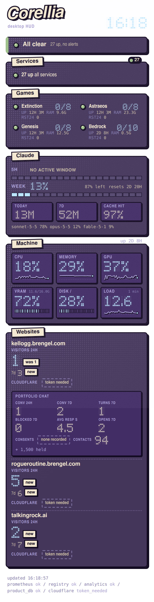
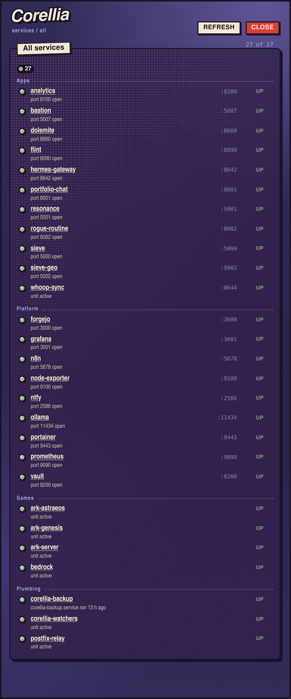

# corellia-hud

A pinned desktop HUD for Corellia. A tall, narrow (about 380 px) column on the right edge of the
desktop that shows, at a glance: a stoplight per custom service Corellia hosts, machine performance
(CPU, memory, GPU, VRAM, disk, load, uptime), web headlines for Kel's sites, and an alerts section
that only expands when something needs attention. It is display-only: it never pages, notifies or
mutates anything.

<p align="center">
  
  &nbsp;&nbsp;
  
</p>

> **A personal tool.** This is the dashboard for one specific home server (Corellia, Ubuntu + GNOME). Paths,
> service registry, game servers and sites are wired to that machine; treat it as a worked example of a
> loopback-only, read-only desktop HUD rather than a drop-in product. Screenshots are live.

Licensed MIT (see `LICENSE`). The GNOME Shell extension in `extension/` runs inside GNOME Shell and uses its
GPL-licensed APIs; MIT is GPL-compatible, so it can be redistributed under GPL-2.0-or-later terms as well.

Spec #481 (issue #791); click-through detail windows and the portfolio-chat tile are Spec #483 (issue #796).

## Architecture

```
Prometheus (tailnet :9090) --+
~/.claude/ops/registry.yaml -+--> aggregator 127.0.0.1:8670 --> WebKit window --> GNOME extension
~/data/analytics.db (ro) ----+     (stdlib Python,                (GTK3 +          pins it: behind all
product.db health runs (ro) -+      classifies status,             WebKit2 4.1,     windows, all
Cloudflare GraphQL (token) --+      short TTL cache)               frameless)       workspaces, right edge
```

- **Aggregator** (`corellia_hud/`): `python3 -m corellia_hud.server`, binds 127.0.0.1:8670 only,
  stdlib only. It is the single source of truth for status: it classifies every service as
  green / amber / red / grey and the page renders what it is given. Every source fails soft to an
  explicit grey or stale state; a missing source is never shown as healthy.
- **Page** (`static/`): plain HTML/CSS/JS, no third-party assets, no animation loop, polls every 15 s.
  Healthy services pack into a two-column grid; problem rows keep full width with port and reason.
- **Window** (`launcher/hud_window.py`): frameless GTK3 + WebKit2 4.1 window with WM_CLASS
  `corellia-hud`, pointing at `http://127.0.0.1:8670/`.
- **Extension** (`extension/corellia-hud-pin@corellia.local`): GNOME Shell 50 extension that matches
  the window by WM_CLASS / title and pins it (below all windows, sticky, right edge, hidden from the
  window list). The geometry comes from the monitor work area at runtime.

Stoplight meaning: green = up, amber = degraded / stale / restart-looping, red = down / failed,
grey = no data. Every lamp also carries a text label (UP / WARN / DOWN / NO DATA).

## Detail windows (Spec #483)

Every stat in the column (service rows, count chips, the all-clear panel, perf tiles, uptime, the website
figures and Cloudflare line, the chat tile, alert rows) is a link. Clicking one opens a floating, frameless
detail window in the HUD theme: `corellia-hud-detail` / "Corellia detail", 560 px wide, beside the column and
above other windows; Esc or the close mark closes it, `R` or the refresh mark re-fetches. There is one window:
clicking another stat re-targets it. The column itself never navigates and stays pinned behind everything.

- `GET /api/detail/<kind>?id=<id>` (loopback, GET-only): `kind` is `service services perf site chat alert` and
  `id` must be a value the aggregator itself currently knows, else 404 (400 if malformed).
- Service windows tail the unit journal (last 20 lines, raw, as the journal wrote them; `corellia_hud/journal.py`
  is the only code that runs journalctl: fixed argv, no shell, 3 s timeout, unit name from the registry only).
- The chat tile shows counts only; its detail window shows recent conversations WITH visitor text. `ip_hash`
  is never served; contact files are counted, never opened. Visitor text is rendered with `textContent` only.
- Launcher: a `target="corellia-hud-detail"` link becomes WebKit's new-window request, which
  `launcher/detail_policy.py` allows only for the aggregator's own detail page. On Wayland GTK3 takes the app
  id from the program name when the window is mapped, so the launcher swaps it for the one show.
- Extension: `match.js` classifies windows (`column` / `detail` / nothing) by exact class or title;
  `extension.js` pins the column and places/raises the detail window. **A changed extension needs a logout
  and login** on Wayland.

## Games section (Spec #484)

A Games panel (between Services and Machine) lists the three ARK maps (Extinction, Astraeos, Genesis) and Minecraft
Bedrock: lamp, players n/max, uptime, RAM (cgroup `memory.current`, includes page cache), CPU (percent of ONE core, `n/a`
on the first sample), restarts in 24 h. Each row opens a `kind=game` detail window (online names, last-seen list, recent
joins, last save, cluster; for Bedrock the loaded add-on packs, join/leave times and the last 20 raw journal lines).

- Sources: Flint's loopback HTTP API (`HUD_FLINT_URL`, default `http://127.0.0.1:8090`; GET only, redirects refused,
  body capped), the unit cgroups and process table, the newest `*.ark` mtime, one UDP server-list datagram to
  `127.0.0.1:19132` (`HUD_BEDROCK_PORT`) and the Bedrock journal. No admin console, no config or credential file is read.
- One cache (`GAMES_TTL` = 30 s) serves every page load and detail open; Flint itself polls every 30 s.
- Lamp: the unit lamp is the floor (`classify.game_lamp`); Flint `offline` or a dead server-list reply raises a green unit
  to amber, never red. A null player count reads `unknown`, a poll older than 120 s reads `stale`, never 0.
- Flint's `last_*` stamps are naive LOCAL time; its event times are UTC.
- Checks: `make test-games test-games-state mutate-games e2e-games live-games-check live-games-unit`.

## Claude usage (Spec #485)

A Claude panel (between Games and Machine) shows how much of the 5-hour and weekly Claude limits is used and when
each resets (5H, WEEK bars, amber from 80%, red from 95%, never an alert and never the all-clear), plus tokens burned
(TODAY, 7D, CACHE HIT) and the model mix. Every figure opens a `kind=claude` detail window (`limits`, `usage`,
`models`, `projects`): hourly and daily volume bars, cache hit rate, peak hour, longest session (wall-clock span),
models and projects.

- Consumed: local Claude Code transcripts (`~/.claude/projects/**/*.jsonl`, `HUD_CLAUDE_PROJECTS`), read-only and
  incremental (offset per file, only whole lines, symlinks skipped). Subagent files are included (74% of the lines).
  One API response is several lines: the dedupe key is (message id, request id), global across files, and the copy with
  the LARGEST `output_tokens` wins. Only timestamp, model, four counts, project basename and session id are kept;
  prompt text never is. "Today" is cut at LOCAL midnight (the transcripts are UTC; DST days are 23 or 25 hours).
- Token words: `new tokens` = input + cache write + output (the headline). `cache read` is shown separately as
  "re-read from cache" (it is ~97% of everything processed). `cache hit` = cache read / (cache read + cache write + input).
- History is the transcripts' retention (about a month). A window longer than the history is marked partial with the
  real start date; a day before the first transcript has no bar, never a zero.
- Left: ONE outbound call, Kel's binding decision. `claude_limits.py` (the only module that names the credentials file
  or the host) reads the Claude Code OAuth access token and does a GET to `https://api.anthropic.com/api/oauth/usage`.
  Hardening: fixed host/path/scheme constants (no env var can change them), GET only, no body or query, redirects
  refused, default TLS verification, proxies ignored, body capped at 64 KB, 4 s timeout, one fetch per 300 s on a worker
  thread (state building never waits on it), failure backoff 60 / 120 / 300 / 900 s, `Retry-After` honoured (cap 1 h),
  honest `User-Agent: corellia-hud`. The file is opened `O_RDONLY|O_NOFOLLOW`, must be ours with no group/other bits and
  at most 64 KB, and is re-read on every attempt; only the access token, its expiry and its scopes are taken from it.
  **The HUD never renews a token** (Claude Code owns its sign-in; a renewal here could sign Kel out). An expired token is
  the explicit state `token_expired` and recovers by itself once Claude Code rewrites the file.
- Kill switch: `HUD_CLAUDE_LIMITS=0` in the unit environment (no file read, no request; the panel says OFF).
- Credentials key shape, OBSERVED 2026-11-06 (names and types only): `claudeAiOauth.{accessToken: str, refreshToken: str,
  expiresAt: int (epoch ms), refreshTokenExpiresAt: int, scopes: list[str], subscriptionType: str,
  subscriptionTypeSource: str, rateLimitTier: str}`. The scopes include `user:profile`, which the endpoint needs.
- Response, OBSERVED 2026-11-06: `five_hour` is a JSON **null** while no 5-hour window is active (shown as "no active
  window", never 0%); `seven_day` is `{utilization: 7.0, resets_at: "2026-11-10T19:00:00.219919+00:00"}`, so
  `utilization` is already a percent (0-100); `claude_limits.UTIL_SCALE` is the one constant if that is ever wrong. The
  honest `User-Agent` and the `anthropic-beta: oauth-2025-04-20` header were accepted. Spend fields and the `limits[]`
  array are never read.
- States for the limits source: `ok stale pending disabled no_credentials cred_insecure cred_unreadable cred_malformed
  token_expired needs_reauth scope_missing rate_limited http_error timeout unreachable bad_json too_large
  schema_mismatch`; per window `ok none stale_window bad_value`. A last good value is kept for 2 x TTL as `stale` with its
  age, then withheld. A 401 stops retries until the credentials file changes or 15 minutes pass.
- Fallback if the endpoint is ever blocked or the account policy bites: switch the kill switch on. (Claude Code's own
  statusline hook carries the same figures but needs a settings change outside this repo, so it is not built.)
- Checks: `make test-claude-usage test-claude-limits test-claude-state mutate-claude e2e-claude
  check-claude-secrets GROUP=secret|network|logging|readonly check-claude-secrets-selftest live-claude-check
  live-claude-unit`.

## Compact services (Spec #492)

The Services panel is one summary line plus only what is not up, so the whole column fits the pinned window
(1672 px: `area.height - 2 * MARGIN` in `extension.js`, derived for the 3840x2160 monitor at scale 1.25).

- All up: `27 up all services` and nothing else. Otherwise `23 up, 4 not up`, then one single-line row per not-up
  service (lamp, name, reason, state tag), worst first (red, amber, grey), at most `classify.SERVICES_LIST_CAP` = 4,
  then `+N more`. Grey (no probe, no series) counts as not up and is listed. Game units are counted and listed too.
- Unknown sources never read as up: Prometheus unreachable (grey), collector stale (amber), registry unreadable (grey)
  and an empty registry each print one explicit line with no per-service rows and no `N up`.
- The decision, the lamp level, the ordering and the cap live in `classify.services_summary`, carried in `/api/state`
  as `meta.services_summary` (`state level up total not_up listed more cap`). `hud.js` renders the level it is given.
- Click targets: the summary line and `+N more` open `services/all` (the existing `services` detail kind with one more
  id: every service, grouped, each with its own status; a name opens the `service` window with unit, restarts, timer
  and journal); a row opens `service/<name>`; the count chips and the All-clear banner are unchanged.
- The green count chip is hidden at 0 (a green lamp beside "0" would read as health when nothing is up).
- Checks: `make test-services-compact mutate-services e2e-services live-column-check`. The height gate
  (`tests/e2e/services.e2e.cjs`, `WINDOW_H = 1672`) measures the populated rich column (Claude panel live, four game
  servers, three sites, 27 services); if it fails, lower the cap, never raise the limit or clip with CSS.
  `live-column-check` repeats it against the real aggregator on :8670 (run after `make install`).

## Make targets

| Target | What it does |
|---|---|
| `make test` | all unit suites (the three Claude suites included) |
| `make test-classify`, `test-failsoft`, `test-token`, `test-server`, `test-sources`, `test-journal`, `test-chat`, `test-detail`, `test-launcher-policy` | one suite each |
| `make test-extension` | node tests for `match.js` and the structure of `extension.js` |
| `make launcher-detail-check` | AST check of the detail-window half of the launcher |
| `make e2e-detail` | 11 detail-window scenarios in Chromium (clicks open real popups); writes `tests/e2e/out/detail-*.png` |
| `make live-detail-check` | spare-port aggregator against the REAL journal / chat tree; proves read-only |
| `make live-unit-check` | the installed unit serves the detail routes |
| `make mutate-classify` | five hand-written mutants of the classifier; the suite must kill all 5 |
| `make check-imports` | every import is stdlib or repo-local |
| `make launcher-check` | launcher WM_CLASS matches the extension, URL is loopback (opens no window) |
| `make extension-syntax` | parse-only check of `extension.js` |
| `make e2e` | real aggregator + fake Prometheus / Cloudflare, Chromium via helm's Playwright, 7 scenarios; writes `tests/e2e/out/hud-380.png` |
| `make live-crosscheck` | starts the aggregator on a spare port and compares it to live Prometheus |
| `make live-service-check` | probes the installed unit on 127.0.0.1:8670 and confirms the tailnet address refuses |
| `make test-services-compact`, `mutate-services`, `e2e-services`, `live-column-check` | the compact Services panel: suite, 9 mutants, 7 browser scenarios with the whole-column height gate, live column gate |
| `make install` | see below |

## Install / uninstall

```
make install
```

Copies the extension to `~/.local/share/gnome-shell/extensions/corellia-hud-pin@corellia.local`,
links and enables both user units from `systemd/`, adds the extension to the `enabled-extensions`
gsettings key, and starts ONLY the aggregator (`corellia-hud.service`). The window unit
(`corellia-hud-window.service`, `WantedBy=graphical-session.target`) first starts at your next login.

**A new extension on Wayland needs a logout and login.** GNOME Shell cannot load a newly installed
extension into a running Wayland session. After logging back in, the window unit starts, the
extension finds the window and pins it.

Uninstall:

```
systemctl --user disable --now corellia-hud.service corellia-hud-window.service
rm -rf ~/.local/share/gnome-shell/extensions/corellia-hud-pin@corellia.local
# then remove corellia-hud-pin@corellia.local from: gsettings get org.gnome.shell enabled-extensions
```

## Cloudflare token (web analytics)

No token exists by default; the Cloudflare line on each site shows "token needed" until you add one.

1. In the Cloudflare dashboard open My Profile, API Tokens, Create Token, Custom token.
2. Permissions: **Zone : Zone : Read** and **Zone : Analytics : Read**. Zone resources: include the
   zones for brengel.com and talkingrock.ai (or all zones). Nothing else.
3. Save the token to `~/.config/corellia-hud/cloudflare.token` (the file contains only the token) and
   lock it down:

   ```
   mkdir -p ~/.config/corellia-hud
   chmod 600 ~/.config/corellia-hud/cloudflare.token
   ```

The token is never logged and never appears in `/api/state`.

States shown for the Cloudflare panel:

- `token_needed`: no token file (or it is empty). Create it as above.
- `token_insecure`: the file's mode is wider than 0600. The token is NOT used until you run
  `chmod 600`.
- `cf_error`: Cloudflare answered but returned an API error (bad scope, zone not reachable by this
  token, dataset not available on the plan). It is shown as "api error", never as zeros. Each zone is
  handled independently, so one failing zone does not blank the other.

Not yet verified against a real token: which GraphQL datasets the free plan exposes for 24 h / 7 d,
and whether one token reaches both zones.

## Configuration notes

- Port 8670, loopback only. Prometheus is reached at the tailnet address (it does not answer on
  127.0.0.1).
- The service list is read from `~/.claude/ops/registry.yaml` at runtime (retired / deferred and
  non-hosted kinds are excluded, and so is the HUD itself).
- Beacon data comes from `~/data/analytics.db` and `health_check_runs` from the product DB, both
  opened with `mode=ro`.
